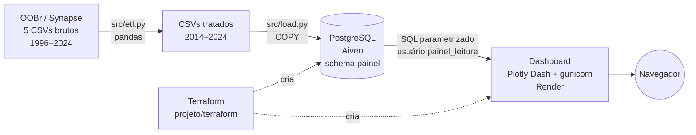

# Painel de Mortalidade Materna: ODS 5 e ODS 18

Trabalho de Big Data & Analytics.

Alunos: Diego Gabriel Pinheiro Damasceno e Flávia Rodrigues Santos Silva.
Professora: Sheila Tirony.

Dashboard sobre as mulheres que morrem na gravidez, no parto e no puerpério no Brasil, de 2014 a
2024. Os dados são do SIM/DATASUS, tratados pelo Observatório Obstétrico Brasileiro (OOBr). Eles
passam por um ETL em Python, ficam num PostgreSQL na Aiven (criado com Terraform) e o dashboard,
feito em Plotly Dash, consulta o banco a cada filtro.

- **ODS 5 (igualdade de gênero):** morte materna evitável e violência contra a mulher na gestação.
- **ODS 18 (igualdade étnico-racial):** essas mortes não atingem todas as mulheres do mesmo jeito.

## Dashboard

**Link: https://painel-mortalidade-materna.onrender.com**

O plano gratuito do Render desliga o serviço depois de 15 minutos sem acesso, então a primeira
visita pode levar uns 50 segundos.

Para rodar na sua máquina (precisa do `.env`, veja `projeto/.env.example`), dentro de `projeto/`:

```bash
pip install -r requirements.txt && python dashboard/app.py
```

Abre em http://127.0.0.1:8050. Como publicar: [projeto/docs/IMPLANTACAO.md](projeto/docs/IMPLANTACAO.md).


## Como funciona



- [src/etl.py](projeto/src/etl.py) lê os CSVs do OOBr, faz o tratamento e grava os CSVs limpos.
- [src/load.py](projeto/src/load.py) cria as tabelas ([sql/schema.sql](projeto/sql/schema.sql)) e
  carrega os dados com `COPY`.
- O Terraform ([projeto/terraform/](projeto/terraform/)) cria o PostgreSQL e o usuário de leitura
  na Aiven e o web service no Render. O [render.yaml](render.yaml) é outra forma de publicar no Render.
- O dashboard ([projeto/dashboard/](projeto/dashboard/)) não usa arquivo nem cache. Cada vez que
  um filtro muda, ele roda 8 consultas SQL no banco ([queries.py](projeto/dashboard/queries.py)),
  e a cada 60 segundos atualiza sozinho. O rodapé mostra a hora da consulta, o banco e o tempo
  gasto, por exemplo:

```
● Consultado no banco às 16:47:47 · PostgreSQL 18.7 · Aiven · 8 consultas, 62 ms
```

- Os filtros vão para o SQL como parâmetros do psycopg2 (`%s`), então ninguém consegue escrever
  SQL pela tela. Na nuvem o dashboard entra com o usuário `painel_leitura`, que só faz `SELECT`
  ([sql/permissoes.sql](projeto/sql/permissoes.sql)).

### Decisões técnicas e o que aprendemos

- **Dash** porque o resto do projeto já era Python. Uma linguagem só para ETL, carga e gráficos.
- **Demora para atualizar.** O banco da Aiven fica a uns 185 ms de distância, e as 8 consultas
  iam uma de cada vez: cada atualização levava 1,9 s. O problema não era o SQL, era o número de
  idas e voltas. Juntamos as 8 num único `SELECT` (cada uma vira uma subconsulta com `json_agg`)
  e ligamos o autocommit. Caiu para 0,2 a 0,3 s. No Render (Virginia, perto do banco em Nova
  York) fica entre 60 e 200 ms.
- **Pouca memória.** O Render gratuito tem 512 MB, então o gunicorn roda com 1 processo e 4
  threads. O pool abre no máximo 5 conexões (o limite da Aiven gratuita é 20).
- **Porcentagem com poucos casos.** Grupos com menos de 20 óbitos ficam sem porcentagem no mapa
  e na matriz, porque um óbito a mais mudaria o número em vários pontos.
- **Mapa.** O contorno das UFs foi simplificado de 3,3 MB para 165 KB.

Mais detalhes em [projeto/docs/DECISOES.md](projeto/docs/DECISOES.md).

## Os indicadores

São 4 indicadores principais e 1 extra. Todos mudam com os filtros. Os valores abaixo são do
Brasil inteiro, de 2014 a 2024.

| # | Indicador | Valor | Como é calculado | Por que importa |
|---|---|---|---|---|
| 1 | **Óbitos maternos oficiais** | 18.534 (média de 1.685 por ano) | `SUM(qtd_obitos)` na tabela de óbitos oficiais | Mostra o tamanho do problema, o pico da COVID-19 e o ano preliminar de 2024. |
| 2 | **Mulheres negras** | 65,9% | (pretas + pardas) ÷ óbitos com raça/cor informada | Indicador central da ODS 18: quem morre. |
| 3 | **Causas obstétricas diretas** | 60,2% | óbitos com `tipo_morte_materna = 'Direta'` ÷ total | Hipertensão, hemorragia e infecção são, em grande parte, evitáveis com bom pré-natal e parto (ODS 5 e meta 3.1). |
| 4 | **Sem investigação do Comitê de Mortalidade Materna (CMM)** | 77,0% | óbitos com `investigacao_cmm ≠ 'Sim'` ÷ total | Mede a vigilância. Morte que não é investigada não ensina nada ao sistema. |
| 5 | **Assassinadas** (extra) | 1.217 (69% negras) | óbitos de grávidas e puérperas por agressão (CID-10 X85–Y09), que ficam fora da contagem oficial | Violência contra a mulher (ODS 5, meta 5.2) que a estatística de morte materna não mostra. |

Os gráficos cruzam esses indicadores:

- **Série por ano e raça/cor**, em número ou em % do ano.
- **10 principais causas (CID-10)**, separando diretas e indiretas.
- **Mapa por UF** e **matriz interseccional** (raça/cor × faixa etária, região ou momento do
  óbito). Os dois mostram o "indicador em foco" escolhido na tela. A matriz também pode ser vista
  como tabela.
- **Violência:** óbitos por causas externas por ano e por tipo.
- **Leitura rápida:** frases calculadas na hora com os filtros escolhidos.

**Filtros:** período, região, UF (a lista muda conforme a região), raça/cor e faixa etária.

## Análise crítica: o que os dados mostram

### 1. A morte materna tem cor (ODS 18)

Duas em cada três mulheres que morreram eram negras (65,9%). Cruzando com a região, fica pior:

| Região | % de mulheres negras entre os óbitos | % sem investigação do CMM |
|---|---|---|
| Nordeste | 82,4% | 95,2% |
| Norte | 77,1% | 99,2% |
| Centro-Oeste | 66,8% | 71,3% |
| Sudeste | 57,3% | 56,1% |
| Sul | 28,3% | 68,1% |

Onde morrem mais mulheres negras, quase nenhuma morte é investigada pelo Comitê. A desigualdade
racial e a regional andam juntas.

### 2. As mulheres indígenas são as mais esquecidas

São poucos casos (308 óbitos), mas o padrão é o mais grave do painel:

- **75% morreram por causas obstétricas diretas**, contra 57% das brancas. As hemorragias
  (CID O44–O46, O67 e O72) são 17,5% dos óbitos de indígenas, contra 9% a 11% entre pardas,
  pretas e brancas. Isso aponta falta de acesso rápido a um parto seguro.
- **96% não foram investigadas** pelo Comitê. Entre brancas, 70%.
- **24% eram adolescentes** (menos de 20 anos). Entre brancas, 8%.

### 3. A COVID-19 quase dobrou as mortes

Os óbitos foram de 1.576 em 2019 para 3.030 em 2021 (+92%). Quase todo o aumento veio de causas
indiretas: a categoria O98 (doenças infecciosas na gravidez, onde entra a COVID-19) foi de 45 para
1.590 óbitos. Em 2021 morreram mais mulheres por causas indiretas (1.940) do que diretas (1.029),
o que não acontece em nenhum outro ano.

Em proporção, o aumento foi maior entre brancas (+121%) do que entre pretas (+93%) e pardas
(+78%). Mesmo assim, em 2021 as mulheres negras continuaram sendo 63% dos óbitos.

### 4. A violência que a contagem oficial não mostra (ODS 5)

A contagem oficial de morte materna deixa de fora as causas externas. Mesmo assim, **1.217
grávidas e puérperas foram assassinadas** no período (CID X85–Y09):

- 69% eram negras;
- 21% eram adolescentes;
- 57% foram mortas durante a gestação.

É mais do que todas as mortes por hemorragia pós-parto (1.151). Somando homicídio, suicídio e
acidentes, foram 3.148 gestantes e puérperas mortas por causas externas. Isso liga a saúde
materna à meta 5.2 da ODS 5 (acabar com a violência contra mulheres e meninas).

### 5. Limites

- **Não calculamos a razão de mortalidade materna**, porque ela precisa dos nascidos vivos do
  SINASC, que não estão nesses arquivos. Por isso o painel mostra contagens e proporções. Os 66%
  de mulheres negras devem ser lidos junto com quantas mulheres negras têm filhos. O próximo
  passo seria trazer o SINASC por raça/cor da mãe e calcular o risco.
- **2024 é preliminar.** Os arquivos são de fevereiro de 2025, então 2024 tem só cerca de metade
  dos óbitos dos outros anos. A queda não é real.
- **"Sem investigação do CMM" junta "Não" e "Sem informação".** Parte da diferença entre estados
  pode ser falha de preenchimento. Nos dois casos a vigilância é fraca.
- **A raça/cor é declarada na Declaração de Óbito**, preenchida por outra pessoa. 2,3% dos
  registros oficiais têm raça/cor ignorada e ficaram fora do indicador 2.

## Critérios de inclusão e exclusão

O passo a passo está em [projeto/docs/DECISOES.md](projeto/docs/DECISOES.md) e as contagens de
cada etapa em [projeto/docs/log_etl.txt](projeto/docs/log_etl.txt). Resumindo:

- **Período:** 2014 a 2024, com 2024 marcado como `preliminar`.
- **Óbitos oficiais:** todos mantidos, inclusive os 21 com 50 anos ou mais, porque já foram
  investigados e contam no número oficial. Idade 99 (ignorada) virou nula.
- **Óbitos desconsiderados:** saíram os de menos de 10 anos (881, quase sempre declarações de
  bebês marcadas como gestação por engano) e os de 50 anos ou mais (1.763).
- **Conferência:** os totais batem entre `maternos_oficiais`, `analise_cruzada` e `ufs` (48.933
  óbitos de 1996 a 2024), e o MD5 dos arquivos confere com o `manifest.csv`.

## Pastas

```
.
├── README.md
├── render.yaml            outra forma de publicar no Render
└── projeto/
    ├── data/raw/          os 5 CSVs do OOBr e o manifest.csv
    ├── data/processed/    os 2 CSVs tratados
    ├── src/               etl.py e load.py
    ├── sql/               schema, permissões e consultas de conferência
    ├── dashboard/         app.py (tela e gráficos), queries.py (SQL), db.py (conexão)
    ├── terraform/         Aiven e Render
    └── docs/              decisões, infraestrutura, implantação, segurança e log do ETL
```

## Como reproduzir do zero

Precisa de Python 3.10+ e Terraform 1.6+. Tudo roda de dentro de `projeto/`.

```bash
cd projeto
pip install -r requirements.txt

# 1. tratamento: lê data/raw e grava data/processed e docs/log_etl.txt
python src/etl.py

# 2. infraestrutura (detalhes em docs/INFRAESTRUTURA.md)
cd terraform
cp terraform.tfvars.example terraform.tfvars
export AIVEN_TOKEN=...
terraform init && terraform apply
echo "DATABASE_URL=$(terraform output -raw database_url)" > ../../.env
cd ..

# 3. carga e permissões do usuário de leitura
python src/load.py
psql "$(terraform -chdir=terraform output -raw database_url)" -f sql/permissoes.sql

# 4. dashboard
python dashboard/app.py
```

Para conferir a carga, rode `sql/consultas_verificacao.sql` no DBeaver, pgAdmin ou `psql`.

## Fonte dos dados

Observatório Obstétrico Brasileiro (OOBr). *Óbitos de gestantes e puérperas, 1996–2024*, versão 4
(fevereiro de 2025), no Synapse (syn42902915), com base no SIM/DATASUS do Ministério da Saúde.
