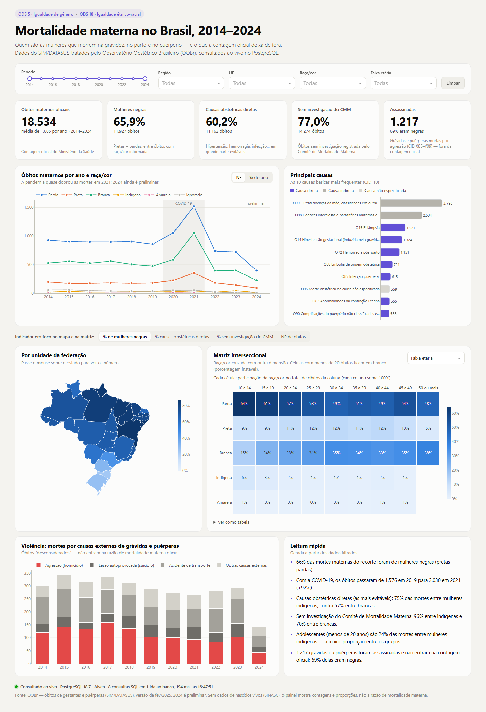
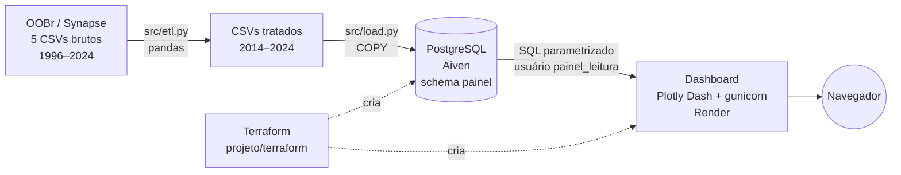

# Painel de Mortalidade Materna: ODS 5 e ODS 18

Trabalho da disciplina de Big Data & Analytics.

**Alunos:** Diego Gabriel Pinheiro Damasceno e Flávia Rodrigues Santos Silva.  
**Professora:** Sheila Tirony.

O projeto mostra os casos de morte materna no Brasil entre 2014 e 2024. Os dados são do
SIM/DATASUS e foram disponibilizados pelo Observatório Obstétrico Brasileiro (OOBr). Passamos
os arquivos por um ETL em Python, carregamos as informações em PostgreSQL na Aiven e usamos um
dashboard feito em Plotly Dash para consultar o banco conforme os filtros.

- **ODS 5 – igualdade de gênero:** morte materna evitável e violência contra mulheres durante a gestação.
- **ODS 18 – igualdade étnico-racial:** as mortes maternas não atingem todas as mulheres da mesma forma.

## Dashboard

Acesse: https://painel-mortalidade-materna.onrender.com

O plano gratuito do Render desliga o serviço quando fica sem uso por 15 minutos. Na primeira
visita depois disso, a página pode demorar cerca de 50 segundos para abrir.

Também é possível executar localmente. É necessário criar o arquivo `.env`; um exemplo está em
`projeto/.env.example`. Dentro da pasta `projeto/`:

```bash
pip install -r requirements.txt
python dashboard/app.py
```

O dashboard fica disponível em http://127.0.0.1:8050.

As instruções de publicação estão em
[projeto/docs/IMPLANTACAO.md](projeto/docs/IMPLANTACAO.md).



## Como o projeto funciona



- [src/etl.py](projeto/src/etl.py) lê os CSVs do OOBr, faz o tratamento e grava os CSVs limpos.
- [src/load.py](projeto/src/load.py) cria as tabelas ([sql/schema.sql](projeto/sql/schema.sql)) e
  carrega os dados com `COPY`.
- O Terraform ([projeto/terraform/](projeto/terraform/)) cria o PostgreSQL e o usuário de leitura
  na Aiven e o web service no Render. O [render.yaml](render.yaml) é outra forma de publicar no Render.
- O dashboard ([projeto/dashboard/](projeto/dashboard/)) não usa arquivo nem cache. Cada vez que
  um filtro muda, ele roda 8 consultas SQL no banco ([queries.py](projeto/dashboard/queries.py)),
  e a cada 60 segundos atualiza sozinho. O rodapé mostra a hora da consulta, o banco e o tempo
  gasto, por exemplo:

```text
● Consultado no banco às 16:47:47 · PostgreSQL 18.7 · Aiven · 8 consultas, 62 ms
```

- Os filtros vão para o SQL como parâmetros do psycopg2 (`%s`), então ninguém consegue escrever
  SQL pela tela. Na nuvem o dashboard entra com o usuário `painel_leitura`, que só faz `SELECT`
  ([sql/permissoes.sql](projeto/sql/permissoes.sql)).

## Indicadores do dashboard

Os valores abaixo usam os dados do Brasil inteiro, de 2014 a 2024.

| # | Indicador | Valor | Cálculo | Por que é mostrado |
|---|---|---|---|---|
| 1 | Óbitos maternos oficiais | 18.534 (média de 1.685 por ano) | `SUM(qtd_obitos)` na tabela de óbitos oficiais | Mostra o tamanho do problema, o pico da COVID-19 e o ano preliminar de 2024. |
| 2 | Mulheres negras | 65,9% | Pretas + pardas divididas pelos óbitos com raça/cor informada | Indicador central da ODS 18 sobre quem está morrendo. |
| 3 | Causas obstétricas diretas | 60,2% | Óbitos com `tipo_morte_materna = 'Direta'` divididos pelo total | Hipertensão, hemorragia e infecção são, em grande parte, evitáveis com pré-natal e parto adequados. |
| 4 | Sem investigação do Comitê de Mortalidade Materna | 77,0% | Óbitos com `investigacao_cmm ≠ 'Sim'` divididos pelo total | Mede a cobertura da vigilância. Quando não há investigação, o sistema perde parte do aprendizado. |
| 5 | Assassinadas | 1.217 (69% negras) | Óbitos de grávidas e puérperas por agressão, CID-10 X85–Y09 | A categoria externa não entra na contagem oficial de morte materna, mas está ligada à violência contra a mulher. |

Os gráficos são modificados pelos filtros de período, região, UF, raça/cor e faixa etária.

- **Série por ano e raça/cor:** pode ser mostrada em número ou em porcentagem do ano.
- **Principais causas por CID-10:** separa causas diretas e indiretas.
- **Mapa por UF:** usa o indicador selecionado na tela.
- **Matriz interseccional:** cruza raça/cor com faixa etária, região ou momento do óbito.
- **Violência:** mostra óbitos por causas externas por ano e por tipo.
- **Leitura rápida:** gera frases a partir dos filtros selecionados.

A matriz pode ser alternada para visualização em tabela.

## O que os dados mostram

### 1. Cor e desigualdade

Duas em cada três mulheres que morreram eram negras: 65,9% do total. A diferença regional aparece
na tabela abaixo.

| Região | Mulheres negras entre os óbitos | Sem investigação do CMM |
|---|---|---|
| Nordeste | 82,4% | 95,2% |
| Norte | 77,1% | 99,2% |
| Centro-Oeste | 66,8% | 71,3% |
| Sudeste | 57,3% | 56,1% |
| Sul | 28,3% | 68,1% |

Nas regiões com maior participação de mulheres negras, a investigação das mortes também costuma
ser menor. Desigualdade racial e desigualdade regional aparecem juntas.

### 2. Mulheres indígenas

Foram registrados 308 óbitos. Mesmo sendo um grupo pequeno, os resultados chamam mais atenção:

- 75% morreram por causas obstétricas diretas, contra 57% das mulheres brancas.
- Hemorragias por CID O44–O46, O67 e O72 representaram 17,5% dos óbitos de indígenas, contra
  9% a 11% entre pardas, pretas e brancas.
- 96% não foram investigadas pelo Comitê, contra 70% das mulheres brancas.
- 24% eram adolescentes, ou seja, menores de 20 anos. Entre mulheres brancas, esse percentual
  foi de 8%.

Esses dados apontam possíveis problemas de acesso rápido a atendimento seguro e também a falta
de investigação.

### 3. COVID-19

O número de óbitos passou de 1.576 em 2019 para 3.030 em 2021, aumento de 92%. A maior parte
veio das causas indiretas. A categoria O98, que inclui doenças infecciosas na gravidez e a
COVID-19, passou de 45 para 1.590 óbitos.

Em 2021, houve 1.940 mortes por causas indiretas e 1.029 por causas diretas. Isso não ocorreu
em nenhum outro ano do período.

O aumento proporcional foi maior entre mulheres brancas (+121%) do que entre pretas (+93%) e
pardas (+78%). Mesmo assim, as mulheres negras continuaram representando 63% dos óbitos em
2021.

### 4. Violência fora da contagem oficial

A contagem oficial deixa as causas externas de fora da morte materna. Neste período, foram
registradas 1.217 mulheres grávidas ou puérperas assassinadas por causas externas no intervalo
CID-10 X85–Y09:

- 69% eram negras;
- 21% eram adolescentes;
- 57% foram mortas durante a gestação.

Esse total é maior que o número de mortes por hemorragia pós-parto, que foi de 1.151.
Considerando homicídio, suicídio e acidentes juntos, foram 3.148 mortes por causas externas.
O resultado liga a saúde materna à meta 5.2 da ODS 5.

## Limites da análise

- Não foi calculada a razão de mortalidade materna porque o arquivo não tem nascidos vivos do
  SINASC. Por isso, o painel mostra contagens e proporções. Os dados de mulheres negras precisam
  ser vistos junto com o número de mulheres negras que têm filhos. O próximo passo seria cruzar
  os dados com o SINASC por raça/cor da mãe e calcular o risco.
- O ano de 2024 é preliminar. Os arquivos são de fevereiro de 2025 e 2024 tem cerca da metade dos
  óbitos dos outros anos. A queda registrada não representa uma tendência real.
- “Sem investigação do CMM” reúne “Não” e “Sem informação”. Parte da diferença entre estados pode
  ser falha de preenchimento. Nos dois casos, a vigilância é fraca.
- A raça/cor é declarada na Declaração de Óbito por outra pessoa. Entre os registros oficiais,
  2,3% têm raça/cor ignorada e ficaram fora do indicador de mulheres negras.

## Decisões técnicas e aprendizados

- **Dash:** a equipe já trabalhava com Python, então foi usada uma única linguagem no ETL,
  carregamento e dashboard.
- **Tempo de atualização:** o banco da Aiven fica a cerca de 185 ms de distância e as oito
  consultas eram feitas separadamente. Isso fazia cada atualização demorar 1,9 s. O problema não
  estava no SQL, mas no número de idas e voltas.
- Para melhorar o tempo, as oito consultas foram agrupadas em um único `SELECT`, em que cada
  consulta virou uma subconsulta com `json_agg`. O autocommit também foi ligado. Depois da
  alteração, o tempo caiu para 0,2–0,3 s. No Render, em Virginia e próximo ao banco em Nova York,
  ficou entre 60 e 200 ms.
- **Memória:** o Render gratuito tem 512 MB. Por isso, o gunicorn roda com um processo e quatro
  threads. O pool tem no máximo cinco conexões, abaixo do limite de 20 da Aiven gratuita.
- **Porcentagens com poucos casos:** grupos com menos de 20 óbitos ficam sem porcentagem no mapa
  e na matriz, porque um óbito a mais poderia alterar muito o resultado.
- **Mapa:** o contorno das UFs foi simplificado de 3,3 MB para 165 KB.

Mais detalhes estão em [projeto/docs/DECISOES.md](projeto/docs/DECISOES.md).

## Critérios de inclusão e exclusão

Os critérios completos estão em [projeto/docs/DECISOES.md](projeto/docs/DECISOES.md), e as
contagens de cada etapa estão em [projeto/docs/log_etl.txt](projeto/docs/log_etl.txt).

- Foram usados registros de 2014 a 2024. O ano de 2024 foi marcado como `preliminar`.
- Nos óbitos oficiais foram mantidos os 21 registros com 50 anos ou mais, pois já haviam sido
  investigados e fazem parte da contagem oficial.
- Nos registros desconsiderados, saíram 881 casos com menos de 10 anos. A maioria parece ser
  declaração de bebê marcada como gestante por erro.
- Também saíram 1.763 registros com 50 anos ou mais.
- A idade 99, usada para indicar dado ignorado, foi convertida para nulo.
- Os totais foram conferidos entre `maternos_oficiais`, `analise_cruzada` e `ufs`. Eles somam
  48.933 óbitos de 1996 a 2024.
- O MD5 dos arquivos foi comparado com o `manifest.csv` e conferiu.

## Estrutura do repositório

```text
.
├── README.md
├── render.yaml                 configuração alternativa do Render
└── projeto/
    ├── data/raw/               arquivos brutos do OOBr e manifest.csv
    ├── data/processed/         arquivos tratados
    ├── src/                    ETL e carga
    ├── sql/                    esquema, permissões e consultas de conferência
    ├── dashboard/              interface, gráficos e consultas
    ├── terraform/              infraestrutura na Aiven e no Render
    └── docs/                   decisões, infraestrutura, implantação, segurança e log do ETL
```

## Reprodução do projeto

São necessários Python 3.10+ e Terraform 1.6+. Os comandos devem ser executados dentro da pasta
`projeto/`.

```bash
cd projeto
pip install -r requirements.txt

# 1. tratamento
python src/etl.py

# 2. infraestrutura
cd terraform
cp terraform.tfvars.example terraform.tfvars
export AIVEN_TOKEN=...
terraform init
terraform apply
echo "DATABASE_URL=$(terraform output -raw database_url)" > ../../.env
cd ..

# 3. carga e permissões
python src/load.py
psql "$(terraform -chdir=terraform output -raw database_url)" -f sql/permissoes.sql

# 4. dashboard
python dashboard/app.py
```

Os detalhes de infraestrutura estão em
[projeto/docs/INFRAESTRUTURA.md](projeto/docs/INFRAESTRUTURA.md).

Para conferir a carga, execute [projeto/sql/consultas_verificacao.sql](projeto/sql/consultas_verificacao.sql)
no DBeaver, pgAdmin ou `psql`.

## Fonte dos dados

Observatório Obstétrico Brasileiro (OOBr). *Óbitos de gestantes e puérperas, 1996–2024*, versão 4
(fevereiro de 2025), disponível no Synapse (syn42902915), com base no SIM/DATASUS do Ministério
da Saúde.
