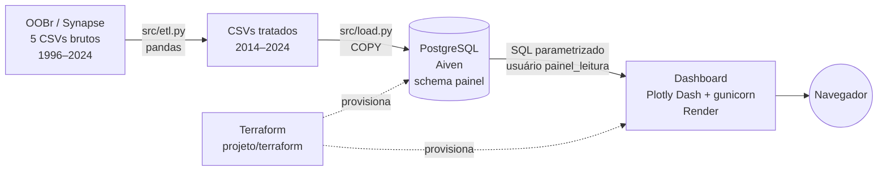

# Painel de Mortalidade Materna: um olhar pela ODS 5 e pela ODS 18

Trabalho de Big Data & Analytics. Fase 2: tratamento, banco e infraestrutura. Fase 3: dashboard.

Alunos: Diego Gabriel Pinheiro Damasceno e Flávia Rodrigues Santos Silva.
Professora: Sheila Tirony.

Painel analítico sobre as mulheres que morrem na gravidez, no parto e no puerpério no Brasil, de 2014
a 2024. Os dados vêm do SIM/DATASUS, tratados pelo Observatório Obstétrico Brasileiro (OOBr). Eles
passam por um ETL em Python, ficam num PostgreSQL na Aiven provisionado com Terraform e são
consultados ao vivo por um dashboard em Plotly Dash.

- **ODS 5 (Igualdade de gênero):** morte materna evitável e violência contra a mulher na gestação.
- **ODS 18 (Igualdade étnico-racial):** a mesma morte não atinge todas as mulheres do mesmo jeito.

## Acesso ao dashboard

**Dashboard publicado: https://painel-mortalidade-materna.onrender.com**

O plano gratuito do Render hiberna depois de 15 minutos sem acesso, então a primeira visita pode
levar cerca de 50 segundos.

Para rodar localmente, com o `.env` configurado (veja `projeto/.env.example`), execute dentro de
`projeto/`:

```bash
pip install -r requirements.txt && python dashboard/app.py
```

O painel abre em http://127.0.0.1:8050. O passo a passo de publicação está em
[projeto/docs/IMPLANTACAO.md](projeto/docs/IMPLANTACAO.md).


## Arquitetura



| Camada | Tecnologia | Onde está |
|---|---|---|
| Extração e tratamento | Python + pandas | [src/etl.py](projeto/src/etl.py) |
| Banco de dados | PostgreSQL gerenciado na Aiven | [sql/schema.sql](projeto/sql/schema.sql) |
| Carga | psycopg2 `COPY` | [src/load.py](projeto/src/load.py) |
| Visualização | Plotly Dash, Bootstrap e gunicorn | [dashboard/](projeto/dashboard/) |
| Infraestrutura como código | Terraform (providers `aiven/aiven` e `render-oss/render`) | [terraform/](projeto/terraform/) |
| Hospedagem do dashboard | Render (web service Python) | [terraform/dashboard.tf](projeto/terraform/dashboard.tf) e [render.yaml](render.yaml) |

### Conexão direta com o banco

O dashboard não usa arquivos nem cache. A cada mudança de filtro, ele executa **8 consultas SQL
agregadas** no PostgreSQL, parametrizadas pelos filtros
([dashboard/queries.py](projeto/dashboard/queries.py)). Um timer também refaz as consultas a cada
60 segundos. O rodapé mostra, como prova ao vivo, a versão do servidor, o número de consultas, o
tempo gasto no banco e o horário. Por exemplo:

```
● Consultado ao vivo · PostgreSQL 18.7 · Aiven · 8 consultas SQL em 1 ida ao banco, 62 ms · às 16:47:47
```

**Otimização.** O servidor da Aiven fica a cerca de 185 ms de distância, e quase todo o tempo de
uma consulta é gasto na rede. Enviadas uma a uma, as 8 consultas levavam 1,9 s. Agora elas seguem
num único `SELECT`, em que cada consulta vira uma subconsulta `json_agg(...)`. As conexões usam
autocommit, o que elimina a ida extra do `ROLLBACK`. O tempo caiu para 0,2 a 0,3 s, cerca de 8
vezes mais rápido, e os dados continuam vindo do banco em tempo real. Na versão publicada, o
servidor do Render (Virginia, EUA) fica perto do banco da Aiven (Nova York), e cada atualização
leva de 60 a 200 ms.

Na nuvem, o dashboard conecta com o usuário `painel_leitura`, que só tem `SELECT` e roda em modo
somente leitura ([sql/permissoes.sql](projeto/sql/permissoes.sql)).

## Os indicadores

Todos os indicadores reagem aos filtros. Os valores abaixo valem para o Brasil, de 2014 a 2024.

| # | Indicador | Valor | Como é calculado | Por que importa |
|---|---|---|---|---|
| 1 | **Óbitos maternos oficiais** | 18.534 (média de 1.685 por ano) | `SUM(qtd_obitos)` na tabela de óbitos oficiais | Tamanho do problema e tendência. Mostra o pico da COVID-19 e o ano preliminar de 2024. |
| 2 | **Mulheres negras** | 65,9% | (pretas + pardas) ÷ óbitos com raça/cor informada | Indicador central da ODS 18: quem morre. |
| 3 | **Causas obstétricas diretas** | 60,2% | óbitos com `tipo_morte_materna = 'Direta'` ÷ total | Hipertensão, hemorragia e infecção puerperal são, em grande parte, evitáveis com pré-natal e parto de qualidade (ODS 5 e meta 3.1). |
| 4 | **Sem investigação do Comitê de Mortalidade Materna (CMM)** | 77,0% | óbitos com `investigacao_cmm ≠ 'Sim'` ÷ total | Mede a vigilância. Morte não investigada é morte da qual o sistema não aprende. |
| 5 | **Assassinadas** (indicador extra) | 1.217 (69% negras) | óbitos de grávidas e puérperas por agressão (CID-10 X85–Y09), que ficam fora da contagem oficial | Violência contra a mulher (ODS 5, meta 5.2) que a estatística de morte materna não enxerga. |

Os gráficos cruzam esses indicadores para mostrar a interseção de raça, idade e território, e não
cada dimensão isolada:

- **Série anual por raça/cor:** número absoluto ou participação de cada grupo no ano.
- **Principais causas (CID-10):** destaca as causas diretas.
- **Mapa por UF** e **matriz interseccional** (raça/cor × faixa etária, região ou momento do
  óbito): ambos seguem o "indicador em foco" escolhido. Na matriz, células com menos de 20 óbitos
  ficam em branco, porque a porcentagem seria instável. A matriz também pode ser vista como tabela.
- **Violência:** óbitos por causas externas, por ano e por tipo.
- **Leitura rápida:** frases calculadas na hora sobre o recorte filtrado.

**Filtros dinâmicos:** período (de um ano a outro), região, UF (a lista se ajusta à região
escolhida), raça/cor e faixa etária, além do seletor do indicador em foco e da dimensão da matriz.

## Análise crítica: o que os dados revelam

### 1. A morte materna no Brasil tem cor (ODS 18)

Duas em cada três mulheres que morreram eram negras (65,9%). Ao cruzar raça com território, a
desigualdade aparece com mais força:

| Região | % de mulheres negras entre os óbitos | % sem investigação do CMM |
|---|---|---|
| Nordeste | 82,4% | 95,2% |
| Norte | 77,1% | 99,2% |
| Centro-Oeste | 66,8% | 71,3% |
| Sudeste | 57,3% | 56,1% |
| Sul | 28,3% | 68,1% |

Nas regiões onde morrem mais mulheres negras, quase nenhuma morte é investigada pelo Comitê. A
desigualdade racial e a regional se reforçam.

### 2. As mulheres indígenas são o grupo mais negligenciado

Os números absolutos são pequenos (308 óbitos), mas a matriz interseccional mostra o padrão mais
grave do painel:

- **75% das mortes foram por causas obstétricas diretas**, contra 57% entre brancas. As causas
  hemorrágicas (hemorragia pós-parto, descolamento de placenta, placenta prévia e hemorragias do
  parto, CID O44–O46, O67 e O72) respondem por 17,5% dos óbitos de indígenas, contra 9% a 11%
  entre pardas, pretas e brancas. Esse padrão indica falta de acesso rápido a um parto seguro.
- **96% não tiveram investigação** do Comitê de Mortalidade Materna. Entre brancas, foram 70%.
- **24% eram adolescentes** (menos de 20 anos). Entre brancas, foram 8%.

### 3. A COVID-19 quase dobrou a mortalidade materna

Os óbitos passaram de 1.576 em 2019 para 3.030 em 2021 (+92%). Quase todo o aumento veio de causas
indiretas. A categoria O98 (doenças infecciosas que complicam a gravidez, onde entra a COVID-19)
saltou de 45 para 1.590 óbitos. Em 2021, mais mulheres morreram de causas indiretas (1.940) do que
de diretas (1.029), uma inversão que não acontece em nenhum outro ano.

Em termos relativos, o salto foi maior entre brancas (+121%) do que entre pretas (+93%) e pardas
(+78%). A pandemia atingiu todos os grupos, mas a desigualdade de base não desapareceu: em 2021,
as mulheres negras continuaram sendo 63% dos óbitos.

### 4. A violência que a contagem oficial não mostra (ODS 5)

A razão de mortalidade materna oficial exclui mortes por causas externas. Mesmo assim, **1.217
grávidas e puérperas foram assassinadas** no período (CID X85–Y09):

- 69% eram negras.
- 21% eram adolescentes.
- 57% foram mortas durante a gestação.

É mais do que todas as mortes por hemorragia pós-parto (1.151). No total, 3.148 gestantes e
puérperas morreram por causas externas: homicídio, suicídio e acidentes. Essas mortes ligam
diretamente a saúde materna à meta 5.2 da ODS 5 (eliminar a violência contra mulheres e meninas).

### 5. Limites desta análise

- **Não calculamos a razão de mortalidade materna**, porque ela exige os nascidos vivos do SINASC.
  O painel mostra contagens e proporções. A participação de 66% de mulheres negras deve ser lida
  junto com o peso delas entre as mulheres que têm filhos. O próximo passo é incluir o SINASC por
  raça/cor da mãe e calcular o risco relativo.
- **2024 é preliminar.** Os arquivos são de fevereiro de 2025, e por isso 2024 tem cerca de metade
  dos óbitos dos outros anos. A queda não é real.
- **"Sem investigação do CMM" junta "Não" e "Sem informação".** Parte da diferença entre estados
  pode ser falha de preenchimento, e não falta de investigação. As duas situações indicam
  fragilidade da vigilância.
- **Raça/cor é declarada na Declaração de Óbito**, preenchida por terceiros. 2,3% dos registros
  oficiais têm raça/cor ignorada e ficaram fora do denominador do indicador 2.

## Critérios de inclusão, exclusão e tratamento

O detalhamento está em [projeto/docs/DECISOES.md](projeto/docs/DECISOES.md), e as contagens de cada
etapa em [projeto/docs/log_etl.txt](projeto/docs/log_etl.txt). Em resumo:

- **Recorte temporal:** 2014–2024, com 2024 marcado como `preliminar`.
- **Óbitos oficiais:** mantidos todos, inclusive os 21 com 50 anos ou mais, porque já foram
  investigados e contam no número oficial. A idade 99 (ignorada) virou nula.
- **Óbitos desconsiderados:** removidos os de menos de 10 anos (881 óbitos, em geral declarações de
  bebês marcadas como gestação por engano) e os de 50 anos ou mais (1.763, fora da idade fértil).
- **Validação:** os totais batem entre os arquivos `maternos_oficiais`, `analise_cruzada` e `ufs`
  (48.933 óbitos de 1996 a 2024), e o MD5 confere com o `manifest.csv`.

## Organização do repositório

```
.
├── README.md                  este arquivo
├── render.yaml                Blueprint do Render (alternativa ao Terraform para publicar o dashboard)
├── .gitignore                 bloqueia .env, state e tfvars do Terraform (ver docs/SEGURANCA.md)
└── projeto/
    ├── requirements.txt       dependências Python (pipeline e dashboard)
    ├── .env.example           modelo do .env com a conexão do banco (sem senha)
    ├── data/
    │   ├── raw/               os 5 CSVs originais do OOBr e o manifest.csv
    │   └── processed/         os 2 CSVs tratados, gerados pelo etl.py
    ├── src/
    │   ├── etl.py             data/raw ──► data/processed
    │   └── load.py            data/processed ──► PostgreSQL
    ├── sql/
    │   ├── schema.sql                  schema painel, tabelas e índices (rodado pelo load.py)
    │   ├── permissoes.sql              usuário só de leitura, usado pelo dashboard
    │   └── consultas_verificacao.sql   consultas para conferir a carga
    ├── dashboard/             aplicação Plotly Dash
    │   ├── app.py             layout, gráficos e callbacks
    │   ├── queries.py         todo o SQL do painel
    │   ├── db.py              pool de conexões, lote de consultas e medição de tempo
    │   ├── br_ufs.geojson     contorno simplificado das UFs para o mapa
    │   └── assets/style.css
    ├── terraform/             PostgreSQL e usuário de leitura na Aiven, web service no Render
    └── docs/
        ├── DECISOES.md        decisões de tratamento e do dashboard
        ├── INFRAESTRUTURA.md  serviços, recursos provisionados e como rodar o Terraform
        ├── IMPLANTACAO.md     como rodar e publicar o dashboard
        ├── SEGURANCA.md       como as credenciais são guardadas fora do repositório
        ├── img/dashboard.png  print do dashboard
        └── log_etl.txt        contagens e validações geradas pelo etl.py
```

## Como reproduzir

Precisa de Python 3.10 ou mais novo e Terraform 1.6 ou mais novo. Os comandos rodam a partir da
pasta `projeto/`.

```bash
cd projeto
pip install -r requirements.txt

# 1. tratamento: lê data/raw e grava data/processed e docs/log_etl.txt
python src/etl.py

# 2. infraestrutura (detalhes em docs/INFRAESTRUTURA.md)
cd terraform
cp terraform.tfvars.example terraform.tfvars
export AIVEN_TOKEN=...
terraform init && terraform apply
echo "DATABASE_URL=$(terraform output -raw database_url)" > ../../.env
cd ..

# 3. carga no banco e permissões do usuário de leitura
python src/load.py
psql "$(terraform -chdir=terraform output -raw database_url)" -f sql/permissoes.sql

# 4. dashboard
python dashboard/app.py
```

Para conferir a carga, rode `sql/consultas_verificacao.sql` no DBeaver, no pgAdmin ou no `psql`.

## Fonte dos dados

Observatório Obstétrico Brasileiro (OOBr). *Óbitos de gestantes e puérperas, 1996–2024*, versão 4
(fevereiro de 2025), disponível no Synapse (syn42902915), com base no SIM/DATASUS do Ministério da
Saúde.
